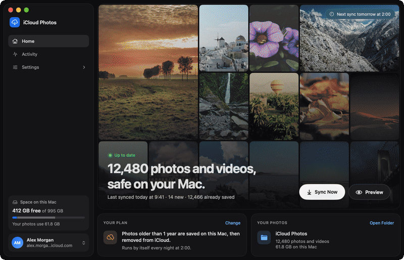
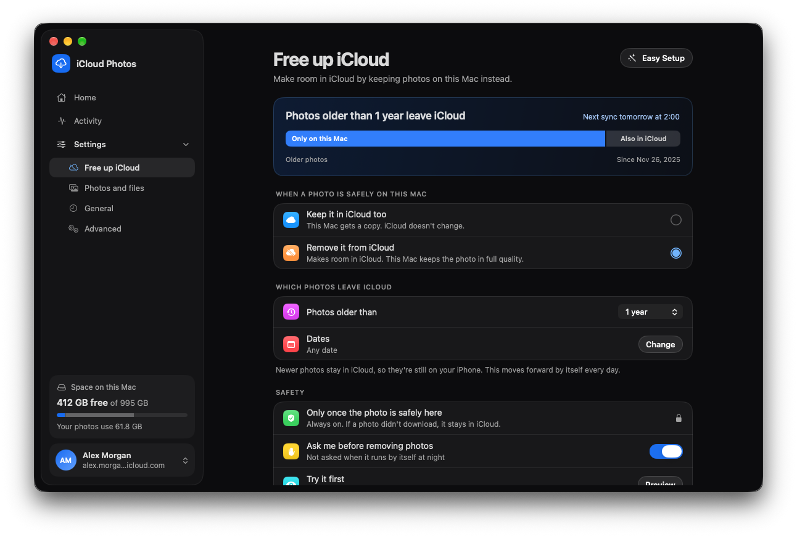

<p align="center">
  
</p>

<h1 align="center">iCloud Photos Downloader for Mac</h1>

<p align="center">
  Keep every photo and video from iCloud in a folder on your Mac, and make room in iCloud while you're at it.<br>
  New: send them to your own <a href="https://immich.app">Immich</a> server instead (alpha).
</p>

<p align="center">
  <a href="https://github.com/iStorry/icloudpd/releases/latest"></a>
  <a href="https://github.com/iStorry/icloudpd/actions/workflows/build.yml"></a>
  
  
</p>

<p align="center">
  
</p>

A native SwiftUI app and command-line tool that download your iCloud Photos library to a folder on your Mac.
It's a Swift reimplementation of the open-source [icloudpd](https://github.com/icloud-photos-downloader/icloud_photos_downloader)
(MIT). It doesn't need Python and doesn't bundle icloudpd. It can also pass your photos on to an
[Immich](https://immich.app) server, so they needn't stay on the Mac at all.

## A look around

<table>
  <tr>
    <td width="50%"></td>
    <td width="50%"></td>
  </tr>
  <tr>
    <td align="center"><b>Home</b><br>Your newest photos, how many are safe on this Mac, and when it syncs next.</td>
    <td align="center"><b>Sync</b><br>Plain-words progress, with each photo as it lands.</td>
  </tr>
  <tr>
    <td width="50%"></td>
    <td width="50%"></td>
  </tr>
  <tr>
    <td align="center"><b>Easy setup</b><br>Three questions: back up only, or free up iCloud space.</td>
    <td align="center"><b>Settings</b><br>Photos leave iCloud only once they're safely on this Mac.</td>
  </tr>
</table>

<sub>Screenshots use a made-up account and stock photos from <a href="https://unsplash.com">Unsplash</a>.</sub>

## Features

- **Sign-in**: Apple ID with the same SRP-6a handshake icloud.com uses. Two-factor codes (trusted device or
  SMS), legacy two-step verification, remembered sessions, and Advanced Data Protection accounts once you
  approve web access on a trusted device. The password can be kept in your login Keychain.
- **What to download**: the primary or a shared library, any albums, Recently Deleted, Hidden.
  Sizes original, medium, thumb, adjusted and alternative, with force-size. Live Photo video sizes. RAW
  pairs, with align-raw. You can skip videos, photos or Live Photo videos.
- **Filters**: created before or after a date (or "20d"), excluded file names, most recent N, and stop
  after N files already on disk (until-found).
- **Files**: folder structure presets or any `{:%Y/%m/%d}` format, a separate Live Photo folder, the Live
  Photo file name policies, name-size dedup or name-id7, optional Unicode removal, set an EXIF date when
  it's missing, and XMP sidecars.
- **Sync**: auto-delete local files removed from iCloud, delete from iCloud after download, keep the last
  N days in iCloud, prune local files that left the library (quarantined, not deleted), a delete list,
  and dry run.
- **Immich (alpha)**: send photos to your own [Immich](https://immich.app) server as they're downloaded,
  instead of keeping them on the Mac or as well as that, and send the photos already in your folder.
  See [Send your photos to Immich](#send-your-photos-to-immich-alpha).
- **Running it**: parallel downloads that resume after interruptions, scheduled runs, a menu bar mode,
  notifications when a run ends, and open at login.

## Send your photos to Immich (alpha)

[Immich](https://immich.app) is a photo server you run yourself. The app can move your library from
iCloud to it, with the Mac only passing the photos along. This is new: look at a few photos in Immich
before you rely on it.

**Set it up**

1. In Immich, click your picture at the top right, then **Account Settings › API Keys**, and make a
   key that is allowed to upload (the `asset.upload` permission).
2. In the app, open **Immich** in the sidebar. Type your server's address, such as
   `http://192.168.1.10:2283`, paste the key, and click **Connect**. The key is kept in your Keychain.
3. Turn on **Send them to Immich**. From then on **Sync Now**, and the nightly sync, send each photo
   to Immich as soon as it's downloaded.

**What it does**

- **Instead of the Mac, or as well**: by default a photo is removed from the Mac once Immich has it,
  so a big library needs almost no space here. Turn on **Keep a copy on this Mac too** to have both.
- **Photos you already downloaded**: **Send Now** sends everything in your photos folder to Immich.
  Those files stay where they are.
- **Nothing twice**: the app remembers what it sent, so a photo isn't downloaded or sent again. Immich
  is also asked first whether it already has a file, so one you added another way isn't uploaded again.
- **Safe with Free up iCloud**: a photo only leaves iCloud once Immich has it. One that didn't arrive
  stays on the Mac and in iCloud, and is sent the next time you sync.
- **Stops early**: if the server is off or the key is refused, the sync stops before downloading anything.
- **Sidecars**: with XMP sidecars on, each photo's sidecar is sent along with it.

**Not yet**

- Deleting a photo in iCloud doesn't delete it from Immich.
- Albums aren't made in Immich. Live Photos go as a photo and a video, which Immich pairs itself.
- The command-line tool has no Immich option.
- A photo is first downloaded to your folder and then sent, so the folder's disk needs room for the
  largest video twice over while it passes through.

## Speed

Measured against the original icloudpd 1.34.0, on the same account with the same options, on an M2 Pro
Mac over home Wi-Fi (26 November 2026). The album had 1,344 photos and videos. Each test ran two or three
times, and the middle result is shown.

| | Original icloudpd | This app | |
|---|---|---|---|
| Download the newest 100 (123 files, 911 MB) | 2 min 34 s | **45 s** | 3.4× faster |
| Sync again when nothing is new | 7.1 s | **4.4 s** | 1.6× faster |
| Look through all 1,344 items | 37.7 s | **34.5 s** | about the same |
| Start up | 1.7 s | **0.005 s** | instant |

Downloads are faster because this app saves 4 files at a time, and the original saves one. Set to one
at a time (`--threads-num 1`), this app took about as long as the original (2 min 42 s to 2 min 58 s).
Looking through the library is mostly waiting for Apple's servers, so both take about the same time.
Times depend on your internet connection.

## Not supported

- **Security keys (FIDO)**: macOS only lets an app use security keys for its own website, so these
  accounts can't sign in. Use a device code account.
- **Email (SMTP) alerts and icloudpd's web UI**: the app uses macOS notifications instead, and the
  command-line tool has `--notification-script`.

## Requirements

- A Mac with macOS 26 Tahoe or later. Xcode 26 or later is only needed to build the app yourself.
- **Settings › [your name] › iCloud › Access iCloud Data on the Web** turned on, on your iPhone or iPad.

## Install and run the app

1. **Let the app reach your photos.** On your iPhone or iPad, open **Settings › [your name] › iCloud**
   and turn on **Access iCloud Data on the Web**.
2. **Download it.** From the [latest release](https://github.com/iStorry/icloudpd/releases/latest),
   download **iCloud-Photos-Downloader-*version*.zip**. Open the zip, and drag **iCloud Photos Downloader**
   to your Applications folder.
3. **Open it the first time.** The app isn't notarized by Apple yet, so macOS stops it the first time
   you open it. Click **Done**, then go to **System Settings › Privacy & Security**, scroll down, and click
   **Open Anyway**. You only need to do this once.
4. **Sign in.** Type your Apple ID and password. Turn on **Remember my password** if you want it to sync
   by itself at night. Then type the six-digit code that shows up on your iPhone, iPad or other Mac. If
   your Apple ID is from mainland China, choose **China mainland** under **Region** first.
   If you use Advanced Data Protection, the app tells you what to approve on your iPhone.
5. **Answer three questions.** The app asks what you'd like to do, and you choose one:
   - **Back up only**: save a copy on this Mac and leave iCloud exactly as it is.
   - **Free up iCloud space**: save the photos on this Mac, then remove them from iCloud. Each photo is
     only removed after it's safely saved.

   Then pick which photos to include, by the date they were taken, and choose a folder to save them in.
   An external drive works too.
6. **Start.** Check your choices on the last page. Click **Preview First** to see what would happen
   without changing anything, or **Start** to begin. If you chose **Free up iCloud space**, first tick the
   box saying you understand the photos will leave iCloud. Leave **Keep it going** on and the app saves
   new photos each night by itself.

After that, the home page shows your newest photos and when the next sync runs. Click **Sync Now** to
sync right away. You can change any of your answers later in **Settings**. To send your photos to an
Immich server, see [Send your photos to Immich](#send-your-photos-to-immich-alpha).

## Build and run

```sh
swift run ICloudPhotos            # the app
./scripts/build-app.sh            # build/iCloud Photos Downloader.app and build/icloudpd-swift
APP_VERSION=1.2.0 ./scripts/build-app.sh   # the same, stamped with a version
```

Every pull request and push to `main` is tested and built on GitHub (`.github/workflows/build.yml`);
the built app is a download on the run's page for a week, when the account has artifact space left.

## Releasing

Run **Actions › Release › Run workflow** and type a version such as `1.2.0`. Once the tests and the
build pass, the commit is tagged `v1.2.0` and a GitHub Release is published with the zipped app, the
command-line tool, SHA-256 checksums and notes from the commits since the last release. Pushing a tag
yourself (`git tag v1.2.0 && git push origin v1.2.0`) does the same. A version with a suffix, such as
`1.2.0-beta.1`, becomes a pre-release.

## Command-line tool

`icloudpd-swift` takes icloudpd's options. To use the one from a release, download
**icloudpd-swift-*version*-macos.zip**, open it, and in Terminal, in the folder it opened into, run:

```sh
xattr -d com.apple.quarantine icloudpd-swift   # once: it isn't notarized, so macOS blocks it otherwise
./icloudpd-swift --username you@example.com --directory ~/Pictures/iCloud
```

From the source code, use `swift run icloudpd-swift` in its place:

```sh
swift run icloudpd-swift --username you@example.com --directory ~/Pictures/iCloud \
  --folder-structure "{:%Y/%m}" --size original --size adjusted --recent 100 --xmp-sidecar
swift run icloudpd-swift --username you@example.com --list-albums
```

The password comes from `--password-provider` (keychain, console, or the `ICLOUD_PASSWORD` environment
variable). A password typed at the console is saved to the Keychain.

## Tests

```sh
swift test
```

SRP is checked byte for byte against vectors from python `srp`, set up as icloudpd sets it up. The sync
engine is tested end to end against a fake iCloud. `ICloudKit` and its tests also build on Linux.
