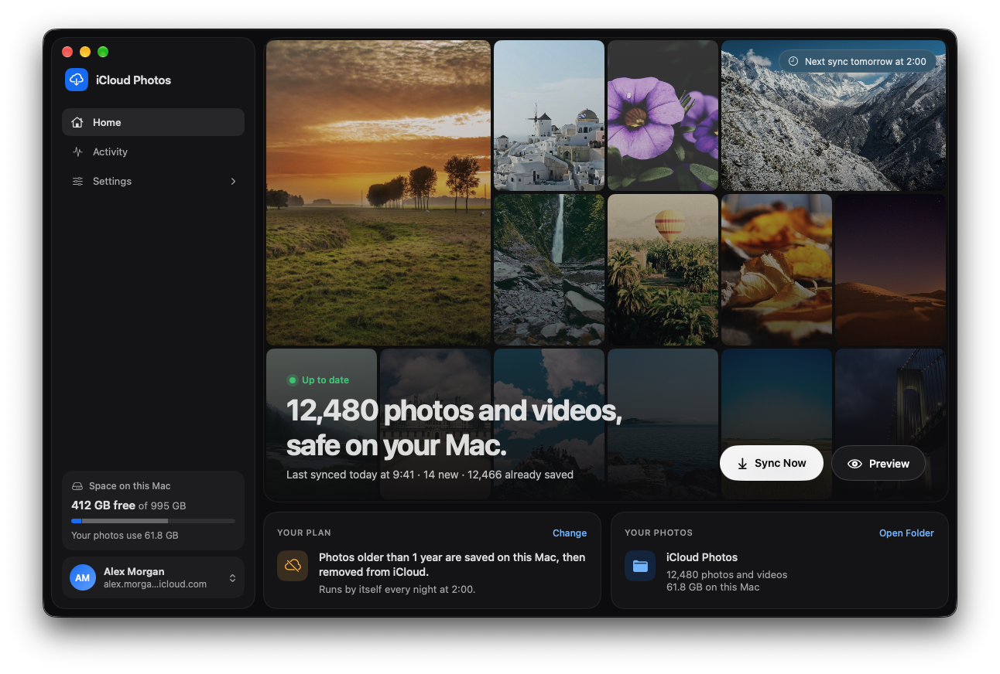
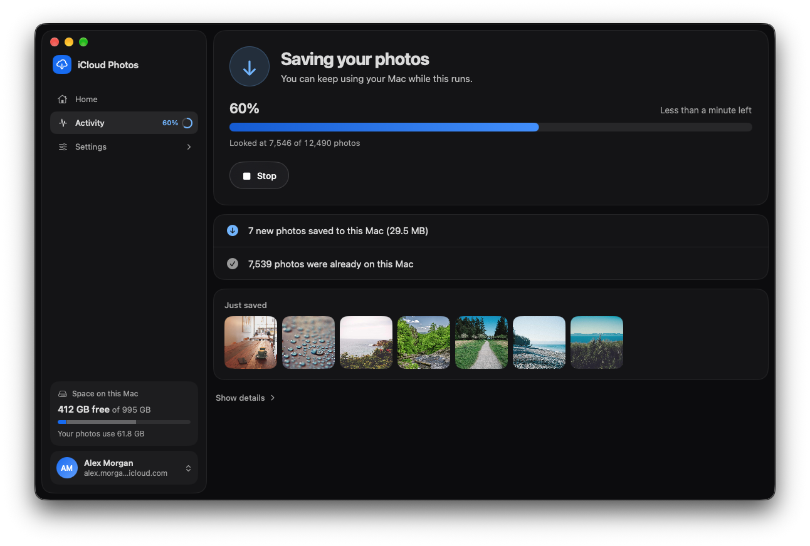
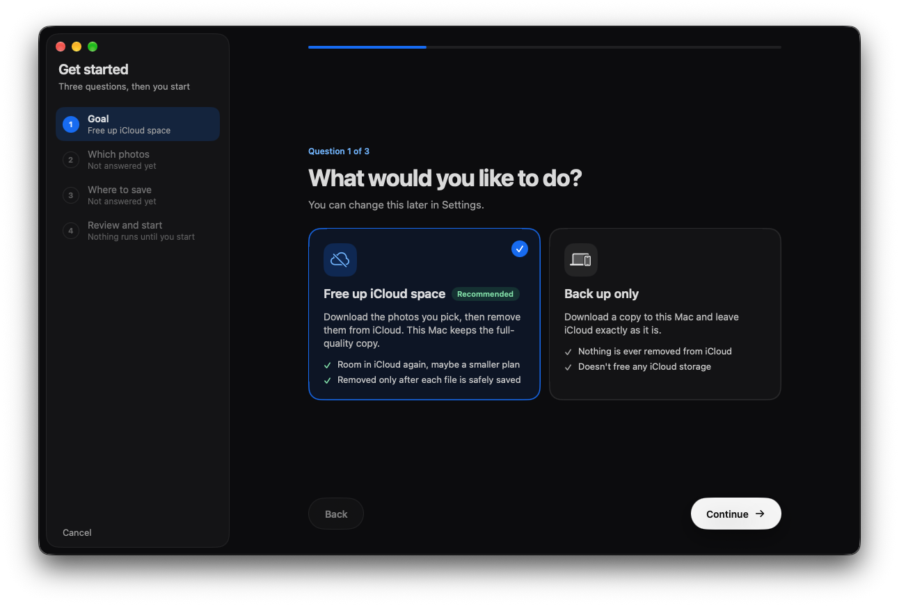

<p align="center">
  
</p>

<h1 align="center">iCloud Photos Downloader for Mac</h1>

<p align="center">
  Keep every photo and video from iCloud in a folder on your Mac, and make room in iCloud while you're at it.
</p>

<p align="center">
  <a href="https://github.com/iStorry/icloudpd/releases/latest"></a>
  <a href="https://github.com/iStorry/icloudpd/actions/workflows/build.yml"></a>
  
  
</p>

<p align="center">
  
</p>

A native SwiftUI app and command-line tool that download your iCloud Photos library to a folder on your Mac.
It's a Swift reimplementation of the open-source [icloudpd](https://github.com/icloud-photos-downloader/icloud_photos_downloader)
(MIT). It doesn't need Python and doesn't bundle icloudpd.

## A look around

<table>
  <tr>
    <td width="50%"></td>
    <td width="50%"></td>
  </tr>
  <tr>
    <td align="center"><b>Home</b><br>Your newest photos, how many are safe on this Mac, and when it syncs next.</td>
    <td align="center"><b>Sync</b><br>Plain-words progress, with each photo as it lands.</td>
  </tr>
  <tr>
    <td width="50%"></td>
    <td width="50%"></td>
  </tr>
  <tr>
    <td align="center"><b>Easy setup</b><br>Three questions: back up only, or free up iCloud space.</td>
    <td align="center"><b>Settings</b><br>Photos leave iCloud only once they're safely on this Mac.</td>
  </tr>
</table>

<sub>Screenshots use a made-up account and stock photos from <a href="https://unsplash.com">Unsplash</a>.</sub>

## Features

- **Sign-in**: Apple ID with the same SRP-6a handshake icloud.com uses. Two-factor codes (trusted device or
  SMS), legacy two-step verification, remembered sessions, and Advanced Data Protection accounts once you
  approve web access on a trusted device. The password can be kept in your login Keychain.
- **What to download**: the primary or a shared library, any albums, Recently Deleted, Hidden.
  Sizes original, medium, thumb, adjusted and alternative, with force-size. Live Photo video sizes. RAW
  pairs, with align-raw. You can skip videos, photos or Live Photo videos.
- **Filters**: created before or after a date (or "20d"), excluded file names, most recent N, and stop
  after N files already on disk (until-found).
- **Files**: folder structure presets or any `{:%Y/%m/%d}` format, a separate Live Photo folder, the Live
  Photo file name policies, name-size dedup or name-id7, optional Unicode removal, set an EXIF date when
  it's missing, and XMP sidecars.
- **Sync**: auto-delete local files removed from iCloud, delete from iCloud after download, keep the last
  N days in iCloud, prune local files that left the library (quarantined, not deleted), a delete list,
  and dry run.
- **Running it**: parallel downloads that resume after interruptions, scheduled runs, a menu bar mode,
  notifications when a run ends, and open at login.

## Not supported

- **Security keys (FIDO)**: macOS only lets an app use security keys for its own website, so these
  accounts can't sign in. Use a device code account.
- **Email (SMTP) alerts and icloudpd's web UI**: the app uses macOS notifications instead, and the
  command-line tool has `--notification-script`.

## Requirements

- macOS 26 Tahoe or later, with Xcode 26+.
- **Settings > [your name] > iCloud > Access iCloud Data on the Web** turned on.

## Download

Each release on the Releases page has the app as **iCloud-Photos-Downloader-*version*.zip**: open it
and drag the app to Applications. The app isn't notarized yet, so the first time macOS stops it; go to
**System Settings › Privacy & Security** and click **Open Anyway**.

## Build and run

```sh
swift run ICloudPhotos            # the app
./scripts/build-app.sh            # build/iCloud Photos Downloader.app and build/icloudpd-swift
APP_VERSION=1.2.0 ./scripts/build-app.sh   # the same, stamped with a version
```

Every pull request and push to `main` is tested and built on GitHub (`.github/workflows/build.yml`);
the built app is a download on the run's page for a week, when the account has artifact space left.

## Releasing

Run **Actions › Release › Run workflow** and type a version such as `1.2.0`. Once the tests and the
build pass, the commit is tagged `v1.2.0` and a GitHub Release is published with the zipped app, the
command-line tool, SHA-256 checksums and notes from the commits since the last release. Pushing a tag
yourself (`git tag v1.2.0 && git push origin v1.2.0`) does the same. A version with a suffix, such as
`1.2.0-beta.1`, becomes a pre-release.

## Command-line tool

`icloudpd-swift` takes icloudpd's options:

```sh
swift run icloudpd-swift --username you@example.com --directory ~/Pictures/iCloud \
  --folder-structure "{:%Y/%m}" --size original --size adjusted --recent 100 --xmp-sidecar
swift run icloudpd-swift --username you@example.com --list-albums
```

The password comes from `--password-provider` (keychain, console, or the `ICLOUD_PASSWORD` environment
variable). A password typed at the console is saved to the Keychain.

## Tests

```sh
swift test
```

SRP is checked byte for byte against vectors from python `srp`, set up as icloudpd sets it up. The sync
engine is tested end to end against a fake iCloud. `ICloudKit` and its tests also build on Linux.
